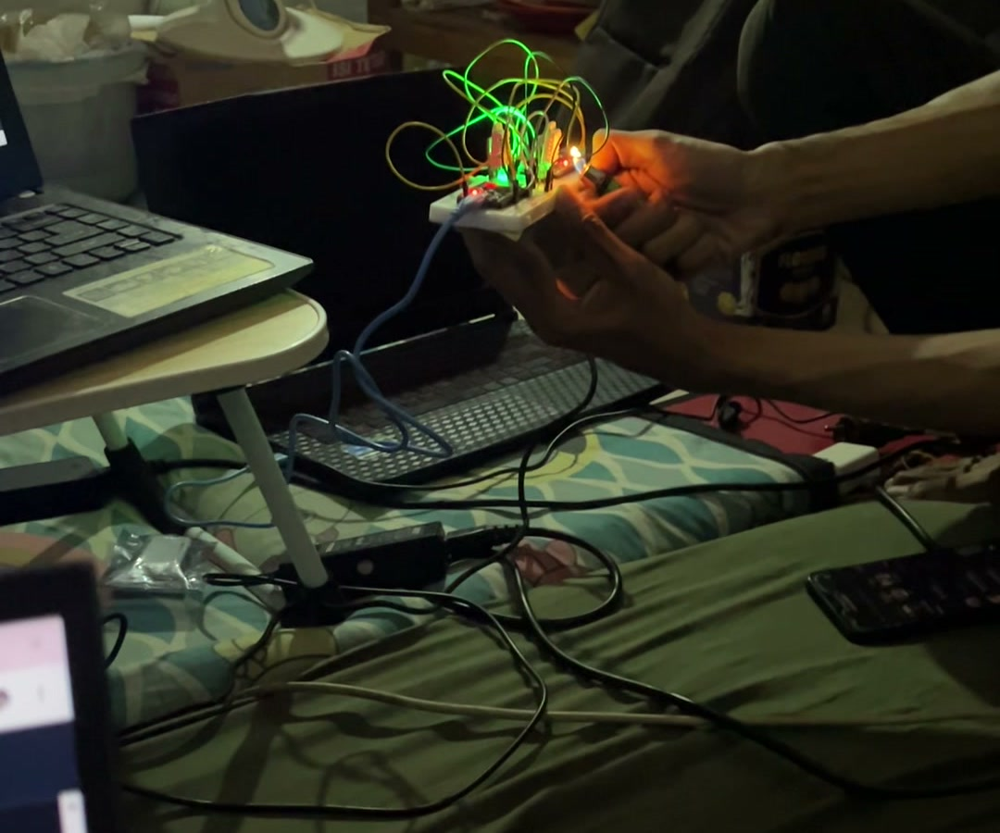
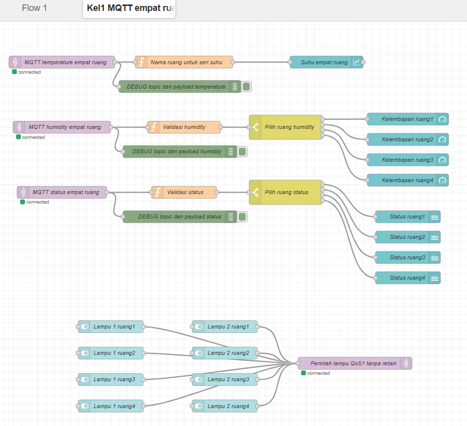
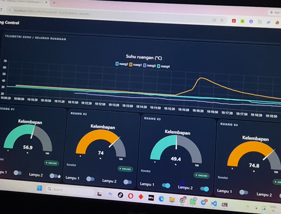

Kelompok 1 - Node-RED dan ESP32

Tugas ini membuat sistem pemantauan empat ruangan menggunakan ESP32, DHT11, MQTT, dan Node-RED. Data suhu ditampilkan dalam satu chart, kelembapan ditampilkan dengan empat gauge, kemudian setiap ruangan mempunyai dua saklar lampu dan indikator online atau offline.

Instruksi tugas: https://hackmd.io/@OkPpYLjoRcu8iYCOtxZkcA/r1vsD7xaMe

Video presentasi: [Google Drive](https://drive.google.com/file/d/1RXAmBEpFWL_j2R8jiQ2R7CQglyxhyUez/view?usp=sharing)

Video demo alat: [Google Drive](https://drive.google.com/file/d/1WcqoYLmbJet25XF7vnzTUILJZRUzmtnv/view?usp=sharing)

Anggota kelompok

| Nama | NRP | Ruangan |
| --- | --- | --- |
| Dzikrina Azaria Salma | 2124600071 | ruang1 |
| Mochammad Aditya Fariz Ramadhani | 2124600082 | ruang2 |
| Ahmad Kholifiy | 2124600088 | ruang3 |
| Achmad Adam Maulana Bisri | 2124600089 | ruang4 |

Alur sistem

```text
ESP32 ruang1 ─┐
ESP32 ruang2 ─┤
ESP32 ruang3 ─┼── broker MQTT ── Node-RED ── dashboard /ui
ESP32 ruang4 ─┘
```

ESP32 mengirim suhu, kelembapan, dan status ke broker. Perintah lampu dikirim dari dashboard Node-RED ke ESP32 melalui broker yang sama.

Perangkat yang dipakai pada setiap ruangan

| Komponen | Pin ESP32 |
| --- | --- |
| DHT11 DATA | GPIO16 |
| LED lampu 1 | GPIO25 |
| LED lampu 2 | GPIO26 |
| DHT11 VCC | 3,3 V |
| DHT11 GND | GND |

Foto rangkaian saat pengujian:



Broker dan topic

Broker yang dipakai adalah `broker.mqttdashboard.com` port `1883`. Prefix MQTT kelompok kami adalah `pens/klp1`.

| Topic | Isi data | QoS | Retain |
| --- | --- | --- | --- |
| `pens/klp1/ruangN/temperature` | suhu dalam °C | 0 | tidak |
| `pens/klp1/ruangN/humidity` | kelembapan dalam % | 0 | tidak |
| `pens/klp1/ruangN/lamp1` | `1` atau `0` | 1 | tidak |
| `pens/klp1/ruangN/lamp2` | `1` atau `0` | 1 | tidak |
| `pens/klp1/ruangN/status` | `online` atau `offline` | 0 | ya |

Dashboard mengikuti susunan tugas dosen: satu tab `Gedung`, satu group `Suhu`, dan satu group untuk setiap ruangan. Di dalamnya terdapat satu chart suhu empat garis, empat gauge kelembapan, delapan saklar lampu, dan empat indikator status.





Laporan: [docs/laporan.pdf](docs/laporan.pdf)

Materi presentasi: [ppt-KEL1.pptx](ppt-KEL1.pptx)

Cara menjalankan

1. Pasang library `EspMQTTClient`, `PubSubClient`, `DHT sensor library`, dan `Adafruit Unified Sensor` di Arduino IDE.
2. Salin `secrets.example.h` menjadi `secrets.h`, lalu isi nama dan password Wi-Fi sendiri. File `secrets.h` tidak ikut diunggah ke GitHub.
3. Buka `esp32/esp32_ruang/esp32_ruang.ino`. Ganti nilai `ROOM` sesuai board yang digunakan, lalu upload ke ESP32.
4. Pasang Node-RED dan paket `node-red-dashboard`.
5. Import `node-red/flows.json`, klik Deploy, lalu buka `http://localhost:1880/ui`.

Hasil pengujian

| Uji | Hasil |
| --- | --- |
| T1 Koneksi ESP32 | belum ada bukti Serial Monitor |
| T2 Data empat ruangan | terlihat pada dashboard |
| T3 Chart empat garis | terlihat pada dashboard |
| T4 Perubahan sensor per ruangan | terlihat sebagian pada video |
| T5 Lampu tepat sasaran | terlihat sebagian pada video |
| T6 Mematikan lampu | terlihat sebagian pada video |
| T7 Payload selain `1` dan `0` diabaikan | belum diuji |
| T8 Status semua ruangan online | terlihat pada dashboard |
| T9 Last Will offline | belum diuji |
| T10 Status retained | belum diuji |
| T11 Reconnect otomatis | belum diuji |
| T12 Dashboard diakses dari HP | belum diuji |

Ruang1 dan ruang2 memakai perangkat fisik, sedangkan ruang3 dan ruang4 menggunakan simulasi. Hasil yang belum mempunyai bukti akan diperbarui setelah pengujian lanjutan.

Pembagian pekerjaan sementara: Dzikrina menangani rangkaian dan dokumentasi ruang1, Fariz menangani MQTT dan Node-RED ruang2, Kholifiy menangani kontrol lampu ruang3, dan Adam menangani status LWT serta dokumentasi ruang4.

Flow awal masih menggunakan topic `gedung/...` dan payload lampu `ON/OFF`. Flow tersebut sudah disesuaikan menjadi `pens/klp1/...` dengan payload `1/0` agar sama dengan instruksi dosen.
